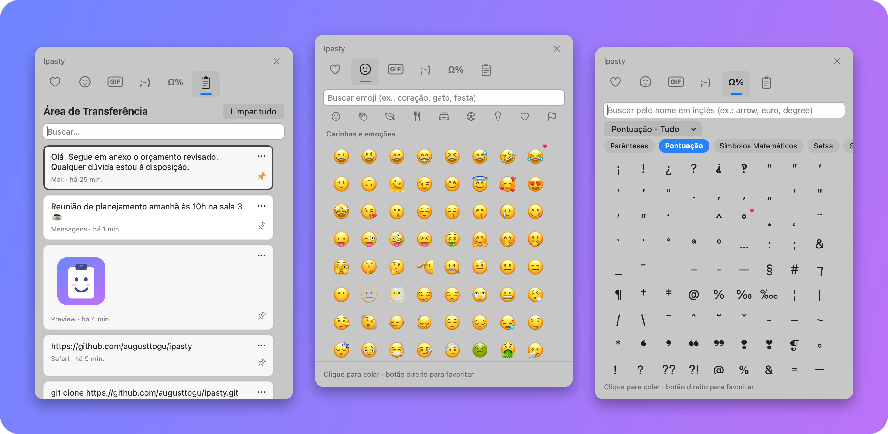

<div align="center">


# Ipasty

**Clipboard history, emoji, GIFs and special characters, all behind one shortcut on your Mac.**

Inspired by the Windows <kbd>Win</kbd> + <kbd>V</kbd> panel, built with native macOS components.

[**⬇️ Download**](https://github.com/augusttogu/ipasty/releases/latest) ·
[Install](#install) ·
[Contributing](CONTRIBUTING.md) ·
[Português](README.md)



</div>

> The app's interface is currently in Brazilian Portuguese. English translation is on the roadmap. Contributions are welcome!

## Features

Press <kbd>⇧</kbd> <kbd>⌘</kbd> <kbd>V</kbd> anywhere and a panel opens next to the cursor with six tabs:

- **Clipboard:** text and image history with search. **Pin** items so "Clear all" keeps them.
- **Favorites and recents:** any emoji, GIF, symbol, kaomoji or text you love.
- **Emoji:** every macOS emoji in 9 categories, with search.
- **GIFs:** trending and search via GIPHY (free personal API key).
- **Kaomoji:** ¯\\\_(ツ)\_/¯ and 140+ more, grouped by mood.
- **Special characters:** the same categories as the macOS Character Viewer, plus the full Unicode table, with official names and code points.

Native Swift/SwiftUI, a few MB, menu-bar only, private (history never leaves your Mac), light and dark mode.

## Install

Requires **macOS 14 Sonoma or later** (Apple Silicon or Intel).

1. Download `Ipasty-x.y.z.zip` from the [latest release](https://github.com/augusttogu/ipasty/releases/latest).
2. Unzip and drag **Ipasty** into **Applications**.
3. The app isn't notarized yet, so the first time you open it go to **System Settings → Privacy & Security** and click **Open Anyway**.
4. Allow **Accessibility** for Ipasty so clicking an item pastes it directly.

Build from source (Command Line Tools only, no full Xcode needed):

```bash
git clone https://github.com/augusttogu/ipasty.git
cd ipasty
./build.sh
```

## License

[MIT](LICENSE). Third-party data and services: [THIRD_PARTY_NOTICES.md](THIRD_PARTY_NOTICES.md). Ipasty is an independent project, not affiliated with Apple, Microsoft or GIPHY.
