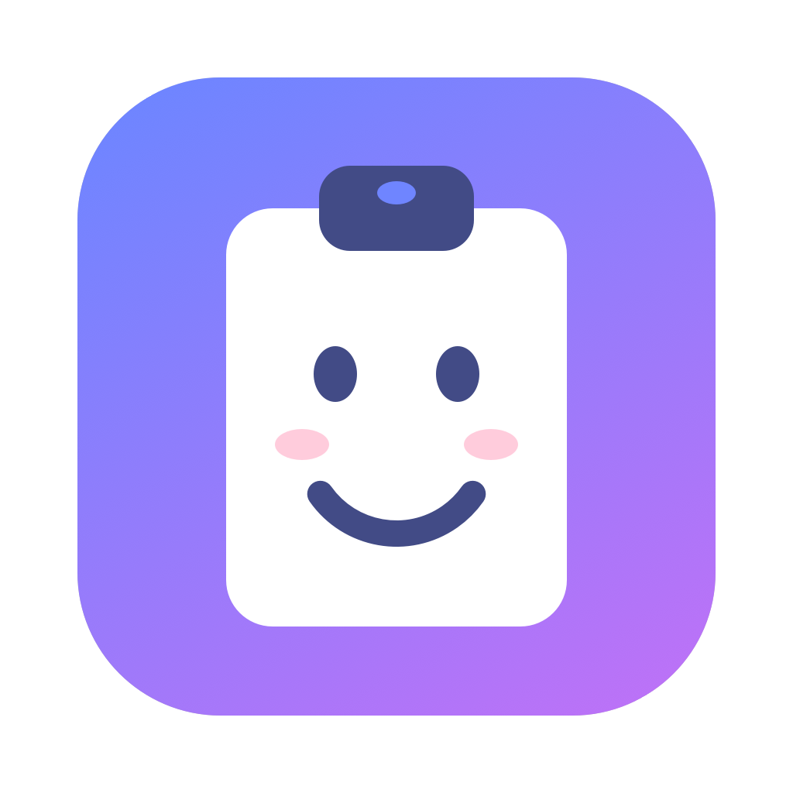
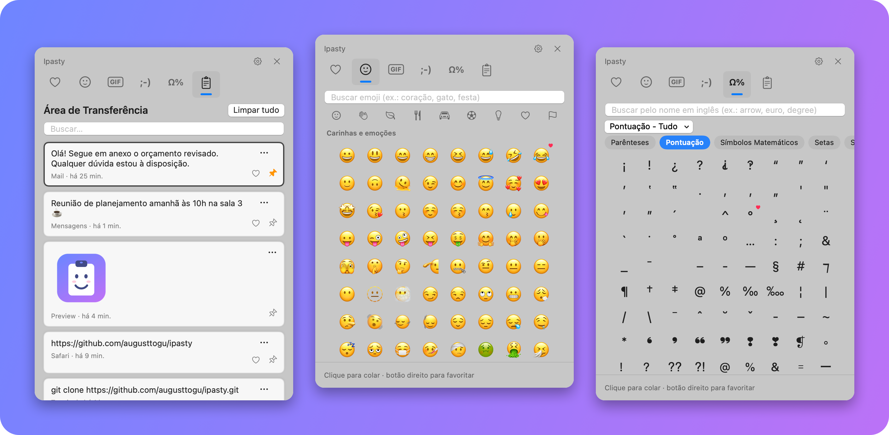
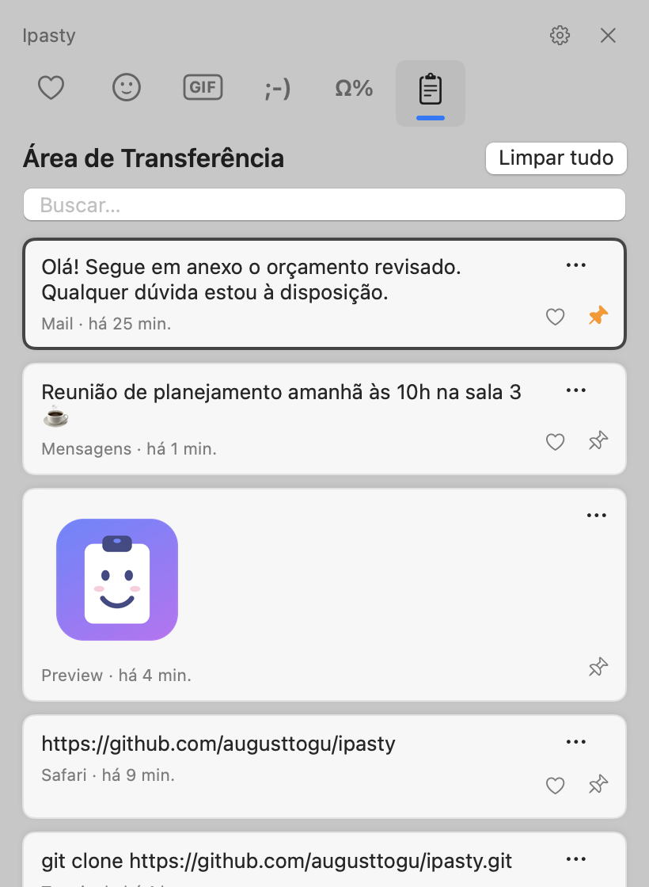
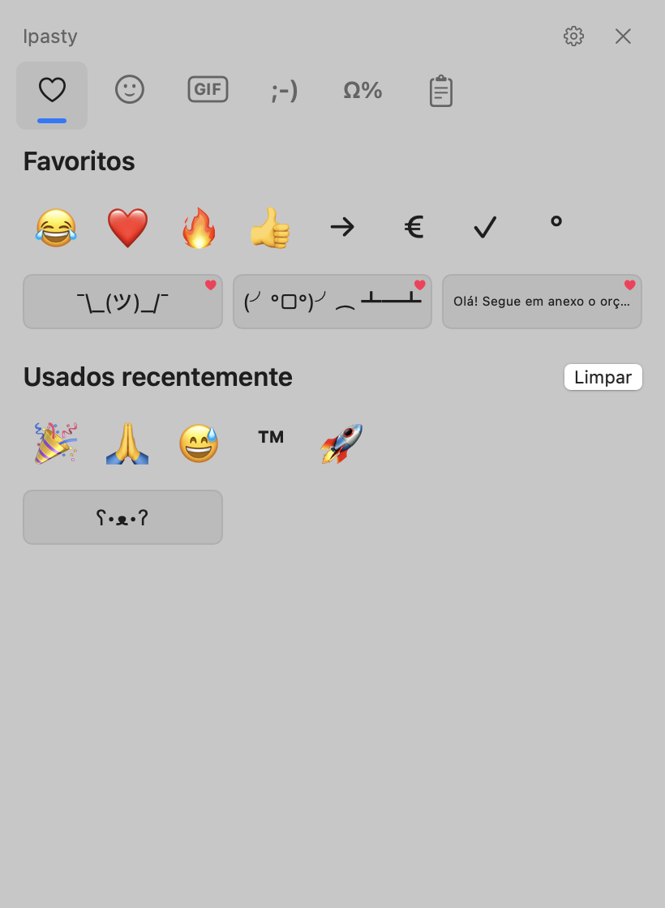
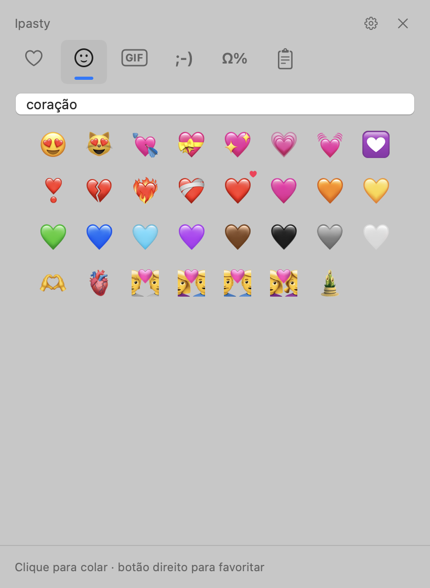
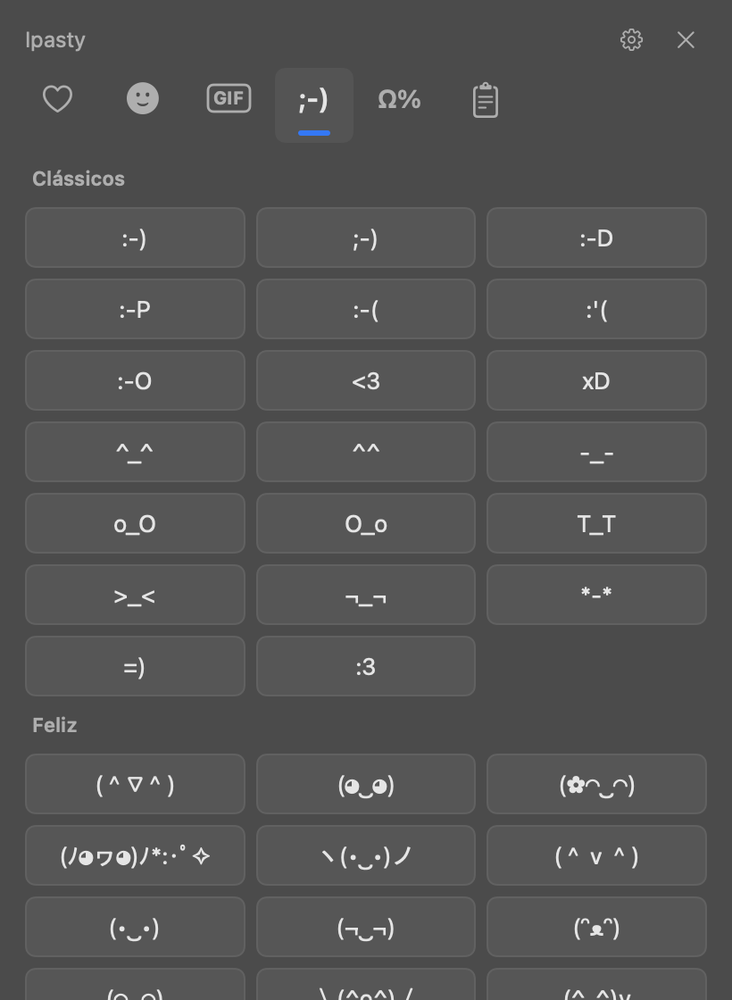
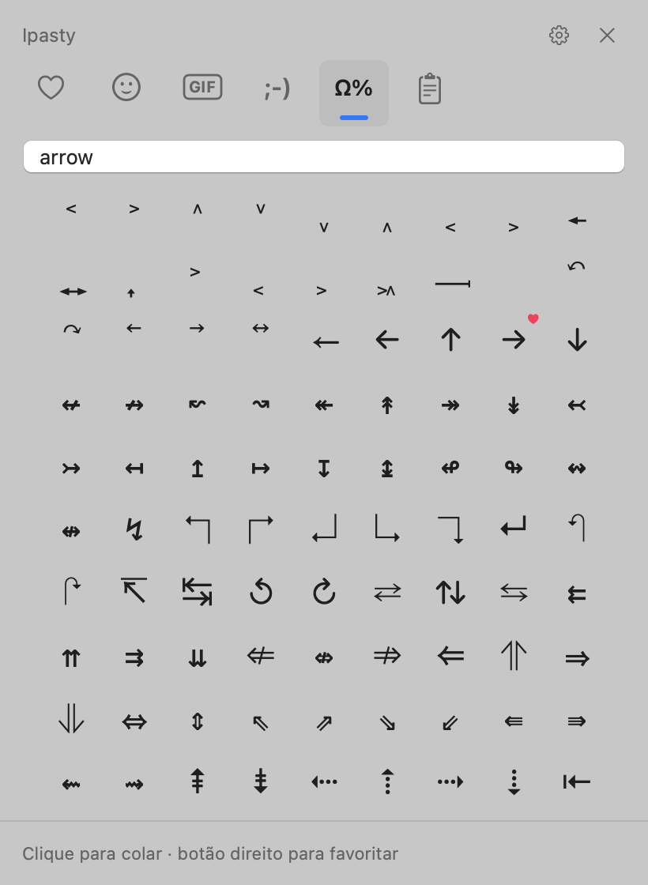
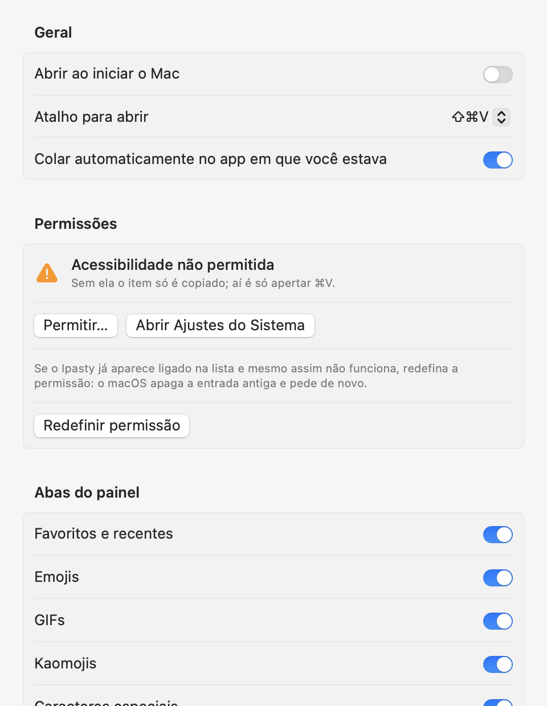

<div align="center">



# Ipasty — Clipboard Manager & Emoji Picker for Mac

**Clipboard history, emoji, GIFs and special characters behind one shortcut on your Mac.**

A free, open-source macOS menu bar app inspired by the Windows <kbd>Win</kbd> + <kbd>V</kbd> panel, built natively for Apple Silicon and Intel Macs with Swift and SwiftUI.

[](https://github.com/augusttogu/ipasty/releases/latest)
[](https://github.com/augusttogu/ipasty/actions/workflows/build.yml)
[](LICENSE)
[](#-install)
[](Sources/Ipasty)
[](https://github.com/augusttogu/ipasty/releases)

[**⬇️ Download for Mac**](https://github.com/augusttogu/ipasty/releases/latest) ·
[Install](#-install) ·
[Shortcuts](#️-keyboard-shortcuts) ·
[Privacy](PRIVACY.md) ·
[Contributing](CONTRIBUTING.md) ·
[Português (BR)](README.pt-BR.md)

<br>

<picture>
  <source media="(prefers-color-scheme: dark)" srcset="docs/screenshots/hero-dark.png">
  
</picture>

</div>

---

## ✨ What it does

Press <kbd>⇧</kbd> <kbd>⌘</kbd> <kbd>V</kbd> in any Mac app and a panel opens next to the cursor with six tabs:

| | Tab | What's inside |
|:-:|---|---|
| 📋 | **Clipboard** | Everything you copy (text and images), searchable. **Pin** 📌 what must stay and **favorite** ♡ what you reuse. |
| ♡ | **Favorites** | Your favorite emoji, GIFs, symbols, kaomoji and text snippets, plus **recently used** items. |
| 🙂 | **Emoji** | Every Apple emoji in 9 categories, with search ("heart", "cat", "party"). |
| 🎞️ | **GIFs** | Trending and search powered by GIPHY. Click and the animated GIF is pasted. |
| ;-) | **Kaomoji** | ¯\\\_(ツ)\_/¯ (╯°□°)╯︵ ┻━┻ ʕ•ᴥ•ʔ and 140+ more, grouped by mood. |
| Ω | **Special characters** | The same categories as the macOS Character Viewer (arrows, currency, math, alphabets…) plus the **full Unicode table**, with official names and code points. |

Plus:

- 🪶 **Lightweight:** a native Mac app (Swift + SwiftUI) of a few MB. No Electron. Lives in the menu bar only.
- ⚙️ **Settings window:** launch at login, choose the global shortcut, turn tabs on or off, history size, image capture, and Accessibility permission status.
- 🚀 **Starts with your Mac:** launch at login is on by default (you can turn it off).
- 🔐 **Asks for permission once:** the Accessibility permission survives app updates.
- ⌨️ **Keyboard first:** arrows, <kbd>Enter</kbd> to paste, <kbd>⌘1</kbd>–<kbd>⌘9</kbd> for the first items.
- 🔒 **Private:** your history stays **on your Mac**. Passwords copied from password managers (1Password, Bitwarden…) are ignored.
- 🌗 Follows macOS **light and dark mode**.

## 🖼️ Gallery

<table>
  <tr>
    <td align="center"><br><sub>Clipboard history with pin and favorite</sub></td>
    <td align="center"><br><sub>Favorites and recents</sub></td>
    <td align="center"><br><sub>Emoji search</sub></td>
  </tr>
  <tr>
    <td align="center"><br><sub>Kaomoji</sub></td>
    <td align="center"><br><sub>Characters with names and code points</sub></td>
    <td align="center"><br><sub>Settings</sub></td>
  </tr>
</table>

## 📦 Install

> Requires **macOS 14 Sonoma or later** on an **Apple Silicon** (M1, M2, M3, M4…) or **Intel** Mac.

### Option 1 — Download (recommended)

1. Download **`Ipasty-x.y.z.zip`** from the [latest release](https://github.com/augusttogu/ipasty/releases/latest).
2. Open the `.zip` and drag **Ipasty** into your **Applications** folder.
3. Open Ipasty. The app isn't notarized by Apple yet, so macOS warns you the first time:
   go to **System Settings → Privacy & Security**, scroll to the Ipasty message and click **Open Anyway**.

> 💡 Prefer the Terminal? After moving it to Applications, run `xattr -dr com.apple.quarantine /Applications/Ipasty.app`.

### Option 2 — Build from source

Only Apple's Command Line Tools are needed (`xcode-select --install`), not the full Xcode.

```bash
git clone https://github.com/augusttogu/ipasty.git
cd ipasty
./build.sh
```

The app is installed to `~/Applications/Ipasty.app` and opens automatically.

📖 Step-by-step guide with troubleshooting: **[docs/INSTALL.md](docs/INSTALL.md)**.

## 🚀 Getting started

1. **Find the clipboard icon** in the Mac menu bar.
2. **Copy anything** and press <kbd>⇧</kbd> <kbd>⌘</kbd> <kbd>V</kbd>.
3. **Allow Accessibility** when asked (System Settings → Privacy & Security → Accessibility → turn on **Ipasty**). This lets a click paste straight into the app you're using. Without it, the item is only copied and you paste with <kbd>⌘</kbd> <kbd>V</kbd>.
4. **(Optional) Enable GIFs:** in the GIF tab, follow the 3 steps to create a free GIPHY key.
5. **Open Settings** from the menu bar icon, the ⚙️ button in the panel, or <kbd>⌘</kbd> <kbd>,</kbd>. Opening Ipasty again from Finder or Spotlight also shows Settings.

## ⌨️ Keyboard shortcuts

| Shortcut | Action |
|---|---|
| <kbd>⇧</kbd> <kbd>⌘</kbd> <kbd>V</kbd> | Open/close Ipasty (can be changed in Settings) |
| <kbd>↑</kbd> <kbd>↓</kbd> and <kbd>Enter</kbd> | Pick and paste a clipboard item |
| <kbd>⌘</kbd> <kbd>1</kbd> … <kbd>⌘</kbd> <kbd>9</kbd> | Paste one of the first 9 items |
| <kbd>⌘</kbd> <kbd>P</kbd> | Pin or unpin the selected item |
| <kbd>⌘</kbd> <kbd>F</kbd> | Add or remove the selected item from favorites |
| <kbd>⌘</kbd> <kbd>⌫</kbd> | Delete the selected item |
| <kbd>⌘</kbd> <kbd>,</kbd> | Open Settings |
| <kbd>⌃</kbd> <kbd>Tab</kbd> / <kbd>⌃</kbd> <kbd>⇧</kbd> <kbd>Tab</kbd> | Next / previous tab |
| Right-click | Add or remove from favorites |
| <kbd>Esc</kbd> | Close |

## ⚙️ Settings

| Setting | Default |
|---|---|
| Launch at login | On |
| Global shortcut (⇧⌘V, ⌥⌘V, ⌃⌘V or ⌃⌥V) | ⇧⌘V |
| Paste automatically into the previous app | On |
| Visible tabs (Favorites, Emoji, GIFs, Kaomoji, Special characters) | All on |
| History size (50 – 1000 items) | 300 |
| Save copied images | On |

The **Permissions** section shows whether Accessibility is granted, opens the right System Settings pane, and has a **Reset permission** button for when Ipasty shows as enabled in the list but pasting still doesn't work.

## 🔒 Privacy

- History, favorites and preferences live in `~/Library/Application Support/Ipasty` and **never leave your Mac**.
- No telemetry, no account, no server of our own.
- The only network connection is to **GIPHY**, and only when you use the GIF tab.

Details in **[PRIVACY.md](PRIVACY.md)**.

## ❓ FAQ

<details>
<summary><b>macOS keeps asking for the Accessibility permission again. Why?</b></summary>

macOS ties the permission to the app's code signature. Older Ipasty builds were signed in a way that changed on every build, so each update looked like a new app. Since **1.1.0** the signature requirement is stable (it's the bundle identifier `io.github.augusttogu.ipasty`), so you grant it **once** and it survives updates. Ipasty also no longer shows the system prompt on every launch.

If you're coming from 1.0.0, open **Settings → Permissions → Reset permission** once to clear the old entry and grant it again.
</details>

<details>
<summary><b><kbd>⇧⌘V</kbd> used to be "Paste and Match Style" in some apps. What now?</b></summary>

Pick another global shortcut in **Settings** (⌥⌘V, ⌃⌘V or ⌃⌥V).
</details>

<details>
<summary><b>Why GIPHY and not Tenor?</b></summary>

Google stopped accepting new apps on the Tenor API in January 2026. The free GIPHY key allows up to 100 searches per hour, which is plenty for personal use.
</details>

<details>
<summary><b>Where do the emoji and character names come from?</b></summary>

From macOS itself (the same names as the Character Viewer), read when the app starts. Emoji order and categories come from the official Unicode file. See [THIRD_PARTY_NOTICES.md](THIRD_PARTY_NOTICES.md).
</details>

## 🗺️ Roadmap

Ideas for upcoming versions. Want to help? Open an [issue](https://github.com/augusttogu/ipasty/issues) or send a pull request.

- [x] Choose the keyboard shortcut in Settings
- [x] Settings window
- [ ] Emoji skin tones
- [ ] Paste as plain text
- [ ] Ignore specific apps in the history
- [ ] English and Spanish interface (currently Brazilian Portuguese)
- [ ] Apple code signing and notarization
- [ ] Homebrew cask

## 🤝 Contributing

Contributions are very welcome, from typo fixes to new features!

- 🐛 Found a bug? [Open an issue](https://github.com/augusttogu/ipasty/issues/new/choose).
- 💡 Have an idea? Use the **feature request** template.
- 🛠️ Want to code? Read the **[contributing guide](CONTRIBUTING.md)**. Every change goes through a pull request and is reviewed before reaching `main`.

By participating you agree to our **[Code of Conduct](CODE_OF_CONDUCT.md)**.

## 📄 License

- Ipasty is free software under the **[MIT License](LICENSE)**.
- It is provided **"as is"**, without warranty.
- Third-party data and services (Unicode, GIPHY, macOS data) have their own terms: **[THIRD_PARTY_NOTICES.md](THIRD_PARTY_NOTICES.md)**.
- Ipasty is an independent project, not affiliated with Apple, Microsoft or GIPHY. Mac, macOS and Apple are trademarks of Apple Inc.

<div align="center">
<br>
Made with ☕ in Brazil by <a href="https://github.com/augusttogu">@augusttogu</a> and <a href="https://github.com/augusttogu/ipasty/graphs/contributors">contributors</a>.
<br><br>

</div>
