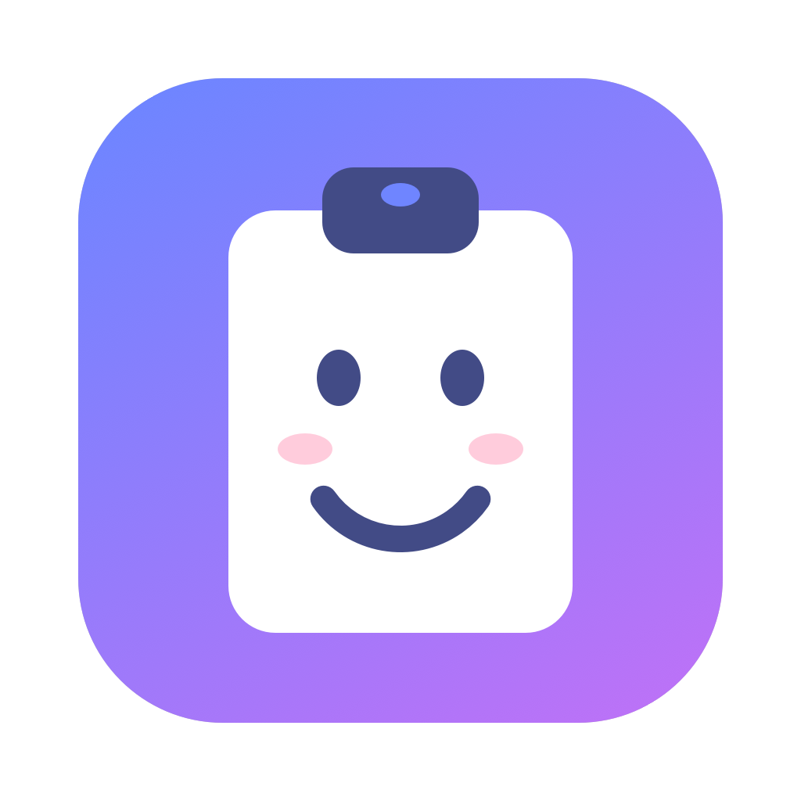
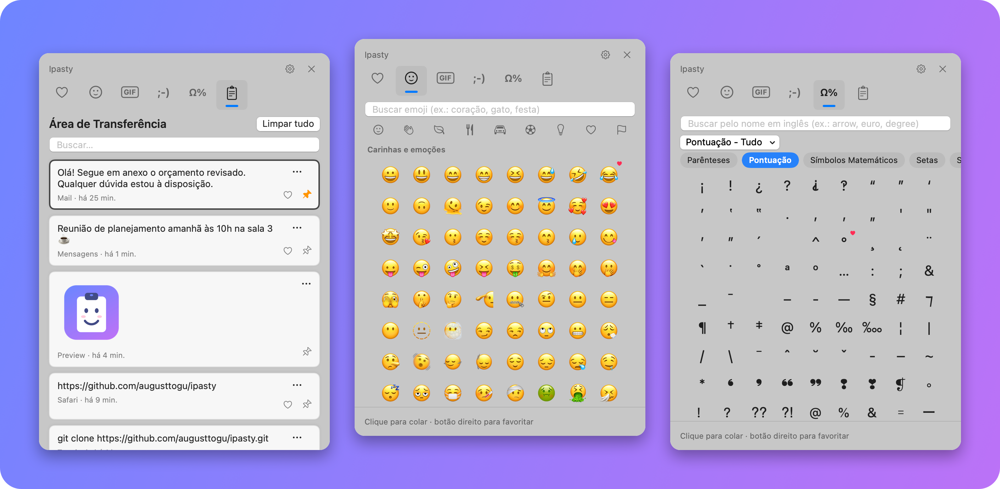
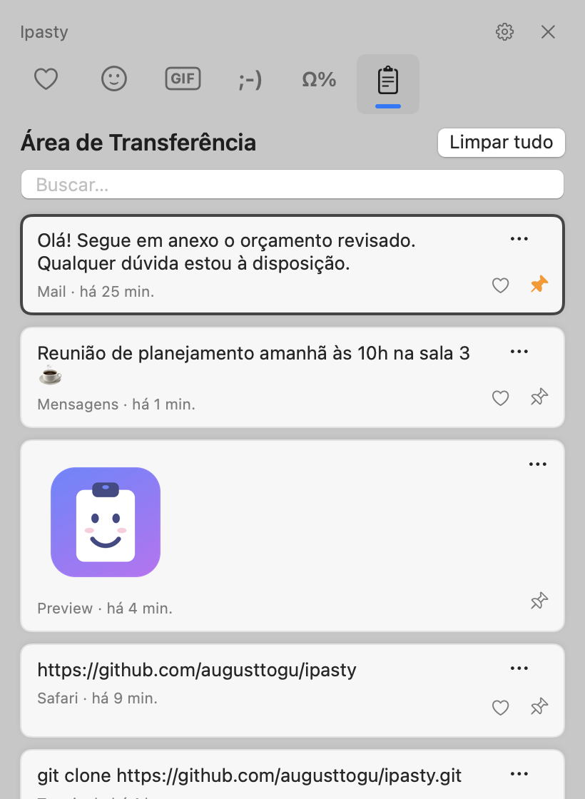
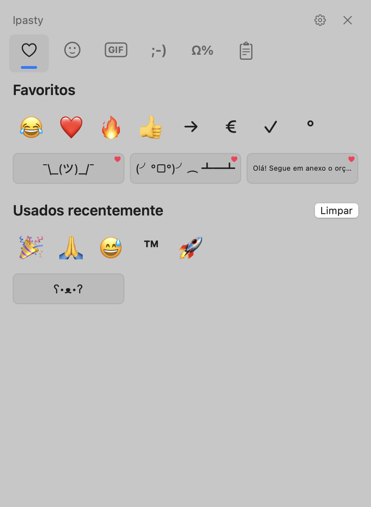
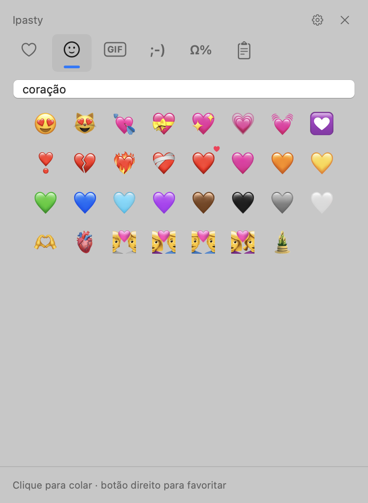
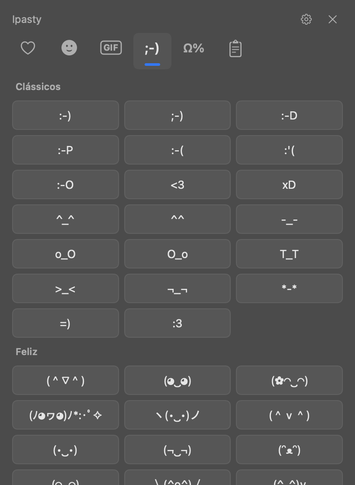
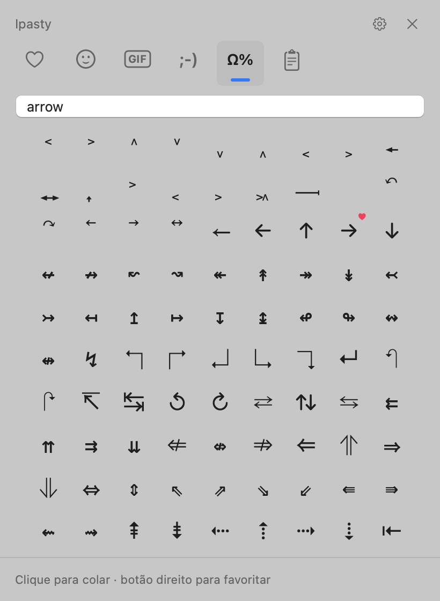
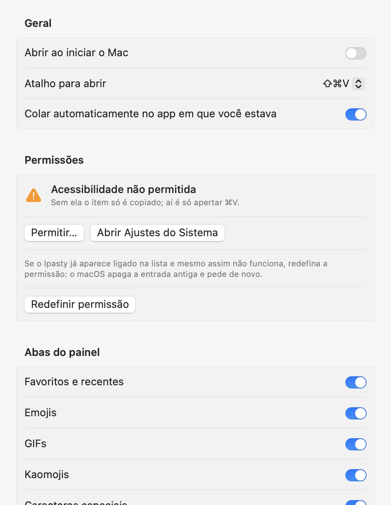

<div align="center">



# Ipasty

**Área de transferência, emojis, GIFs e caracteres especiais — tudo num atalho só, no seu Mac.**

Inspirado no painel <kbd>Win</kbd> + <kbd>V</kbd> do Windows, feito com componentes nativos do macOS.

[](https://github.com/augusttogu/ipasty/releases/latest)
[](https://github.com/augusttogu/ipasty/actions/workflows/build.yml)
[](LICENSE)
[](#-instalação)
[](Sources/Ipasty)
[](https://github.com/augusttogu/ipasty/releases)

[**⬇️ Baixar**](https://github.com/augusttogu/ipasty/releases/latest) ·
[Instalação](#-instalação) ·
[Atalhos](#️-atalhos) ·
[Privacidade](PRIVACY.md) ·
[Contribuir](CONTRIBUTING.md) ·
[English](README.md)

<br>

<picture>
  <source media="(prefers-color-scheme: dark)" srcset="docs/screenshots/hero-dark.png">
  
</picture>

</div>

---

## ✨ O que ele faz

Aperte <kbd>⇧</kbd> <kbd>⌘</kbd> <kbd>V</kbd> em qualquer app e um painel abre perto do cursor com seis abas:

| | Aba | O que tem |
|:-:|---|---|
| 📋 | **Área de transferência** | Tudo o que você copia (textos e imagens), com busca. **Fixe** 📌 o que não pode sumir e **favorite** ♡ o que você reutiliza. |
| ♡ | **Favoritos** | Seus emojis, GIFs, símbolos, kaomojis e textos favoritos, mais os **usados recentemente**. |
| 🙂 | **Emojis** | Todos os emojis do macOS em 9 categorias, com **busca em português** ("coração", "gato", "festa"). |
| 🎞️ | **GIFs** | Busca e GIFs em alta pelo GIPHY. Clique e o GIF animado é colado. |
| ;-) | **Kaomojis** | ¯\\\_(ツ)\_/¯ (╯°□°)╯︵ ┻━┻ ʕ•ᴥ•ʔ e mais de 140 outros, por humor. |
| Ω | **Caracteres especiais** | As mesmas categorias do Visualizador de Caracteres do Mac (setas, moedas, matemática, alfabetos…) e o **Unicode completo**. |

E ainda:

- 🪶 **Leve:** um app nativo (Swift + SwiftUI) de poucos MB, sem Electron, que fica só na barra de menus.
- ⌨️ **Feito para teclado:** setas, <kbd>Enter</kbd> para colar e <kbd>⌘1</kbd>–<kbd>⌘9</kbd> para os primeiros itens.
- ⚙️ **Janela de Ajustes:** abrir ao iniciar, atalho, abas ligadas/desligadas, tamanho do histórico, imagens e status da permissão.
- 🚀 **Abre junto com o Mac** (ligado por padrão; dá para desligar).
- 🔐 **Pede a permissão uma vez só:** a Acessibilidade continua valendo depois das atualizações.
- 🔒 **Privado:** o histórico fica **só no seu Mac**. Senhas copiadas de gerenciadores (1Password, Bitwarden…) são ignoradas.
- 🌗 Acompanha o modo **claro e escuro** do sistema.

## 🖼️ Galeria

<table>
  <tr>
    <td align="center"><br><sub>Área de transferência</sub></td>
    <td align="center"><br><sub>Favoritos e recentes</sub></td>
    <td align="center"><br><sub>Busca de emojis em português</sub></td>
  </tr>
  <tr>
    <td align="center"><br><sub>Kaomojis</sub></td>
    <td align="center"><br><sub>Caracteres com nome e código</sub></td>
    <td align="center"><br><sub>Ajustes</sub></td>
  </tr>
</table>

## 📦 Instalação

> Requer **macOS 14 (Sonoma) ou mais novo**, em Mac com Apple Silicon ou Intel.

### Opção 1 — Baixar pronto (recomendado)

1. Baixe o arquivo **`Ipasty-x.y.z.zip`** da [última versão](https://github.com/augusttogu/ipasty/releases/latest).
2. Abra o `.zip` e arraste o **Ipasty** para a pasta **Aplicativos**.
3. Abra o Ipasty. Como o app ainda não é assinado pela Apple, o macOS vai avisar na primeira vez:
   vá em **Ajustes do Sistema → Privacidade e Segurança**, role até o aviso sobre o Ipasty e clique em **Abrir Mesmo Assim**.

> 💡 Prefere o Terminal? Depois de mover para Aplicativos, rode `xattr -dr com.apple.quarantine /Applications/Ipasty.app`.

### Opção 2 — Compilar a partir do código

Precisa só das Ferramentas de Linha de Comando da Apple (`xcode-select --install`), não do Xcode completo.

```bash
git clone https://github.com/augusttogu/ipasty.git
cd ipasty
./build.sh
```

O app é instalado em `~/Applications/Ipasty.app` e já abre sozinho.

📖 Passo a passo detalhado, com solução de problemas: **[docs/INSTALACAO.md](docs/INSTALACAO.md)** · [English](docs/INSTALL.md).

## 🚀 Primeiros passos

1. **Procure o ícone** de prancheta na barra de menus, lá em cima.
2. **Copie qualquer coisa** e aperte <kbd>⇧</kbd> <kbd>⌘</kbd> <kbd>V</kbd>.
3. **Permita a Acessibilidade** (Ajustes do Sistema → Privacidade e Segurança → Acessibilidade → ative o **Ipasty**). É isso que permite que o clique cole o item direto no app em que você está. Sem a permissão, o item vai só para a área de transferência e você cola com <kbd>⌘</kbd> <kbd>V</kbd>.
4. **(Opcional) Ative os GIFs:** na aba GIF, siga os 3 passos para criar uma chave gratuita do GIPHY.
5. **Ajustes:** pelo ícone na barra de menus, pelo botão ⚙️ do painel ou com <kbd>⌘</kbd> <kbd>,</kbd>. Abrir o Ipasty de novo pelo Finder ou Spotlight também mostra os Ajustes.

## ⌨️ Atalhos

| Atalho | Ação |
|---|---|
| <kbd>⇧</kbd> <kbd>⌘</kbd> <kbd>V</kbd> | Abrir/fechar o Ipasty (dá para trocar nos Ajustes) |
| <kbd>↑</kbd> <kbd>↓</kbd> e <kbd>Enter</kbd> | Escolher e colar um item da área de transferência |
| <kbd>⌘</kbd> <kbd>1</kbd> … <kbd>⌘</kbd> <kbd>9</kbd> | Colar um dos 9 primeiros itens |
| <kbd>⌘</kbd> <kbd>P</kbd> | Fixar ou desafixar o item selecionado |
| <kbd>⌘</kbd> <kbd>F</kbd> | Favoritar ou desfavoritar o item selecionado |
| <kbd>⌘</kbd> <kbd>⌫</kbd> | Apagar o item selecionado |
| <kbd>⌘</kbd> <kbd>,</kbd> | Abrir os Ajustes |
| <kbd>⌃</kbd> <kbd>Tab</kbd> / <kbd>⌃</kbd> <kbd>⇧</kbd> <kbd>Tab</kbd> | Próxima aba / aba anterior |
| Clique direito | Adicionar ou remover dos favoritos |
| <kbd>Esc</kbd> | Fechar |

## 🔒 Privacidade

- O histórico, os favoritos e as preferências ficam em `~/Library/Application Support/Ipasty` e **nunca saem do seu Mac**.
- O Ipasty não tem telemetria, conta, nem servidor próprio.
- A única conexão com a internet é com o **GIPHY**, e só quando você usa a aba GIF.

Detalhes em **[PRIVACY.md](PRIVACY.md)**.

## ❓ Perguntas frequentes

<details>
<summary><b>O <kbd>⇧⌘V</kbd> já fazia "colar sem formatação" em alguns apps. E agora?</b></summary>

Escolha outro atalho em **Ajustes** (⌥⌘V, ⌃⌘V ou ⌃⌥V).
</details>

<details>
<summary><b>Por que GIPHY e não Tenor?</b></summary>

O Google parou de aceitar novos apps na API do Tenor em janeiro de 2026. A chave gratuita do GIPHY permite até 100 buscas por hora, o que sobra para uso pessoal.
</details>

<details>
<summary><b>O macOS fica pedindo a permissão de Acessibilidade de novo.</b></summary>

Até a versão 1.0.0 a assinatura do app mudava a cada compilação, e o macOS tratava cada atualização como um app novo. Desde a **1.1.0** a assinatura usa o identificador fixo do app, então a permissão é dada **uma vez** e continua valendo. Vindo da 1.0.0, abra **Ajustes → Permissões → Redefinir permissão** uma vez.
</details>

<details>
<summary><b>Os nomes dos emojis e caracteres vêm de onde?</b></summary>

Do próprio macOS (os mesmos do Visualizador de Caracteres), lidos na hora em que o app abre. A ordem e as categorias dos emojis vêm do arquivo oficial do Unicode. Veja [THIRD_PARTY_NOTICES.md](THIRD_PARTY_NOTICES.md).
</details>

## 🗺️ Roteiro

Ideias para as próximas versões. Quer ajudar? Abra uma [issue](https://github.com/augusttogu/ipasty/issues) ou mande um pull request.

- [x] Escolher o atalho de teclado nos Ajustes
- [x] Janela de Ajustes
- [ ] Tons de pele nos emojis
- [ ] Colar sem formatação
- [ ] Ignorar apps específicos no histórico
- [ ] Busca de caracteres em português
- [ ] Tradução da interface para inglês e espanhol
- [ ] Assinatura e notarização da Apple
- [ ] Instalação pelo Homebrew

## 🤝 Contribuindo

Contribuições são muito bem-vindas, de correção de texto a funcionalidades novas!

- 🐛 Achou um problema? [Abra uma issue](https://github.com/augusttogu/ipasty/issues/new/choose).
- 💡 Tem uma ideia? Use o modelo de **sugestão de melhoria**.
- 🛠️ Quer programar? Leia o **[guia de contribuição](CONTRIBUTING.md)**. Toda mudança entra por *pull request* e é revisada antes de ir para a versão principal.

Ao participar, você concorda com o nosso **[Código de Conduta](CODE_OF_CONDUCT.md)**.

## 📄 Licença e termos

- O código do Ipasty é livre, sob a **[Licença MIT](LICENSE)**: você pode usar, modificar e redistribuir, mantendo o aviso de copyright.
- O software é fornecido **"como está"**, sem garantias. Veja a licença para os termos completos.
- Dados e serviços de terceiros (Unicode, GIPHY, dados do macOS) têm termos próprios: **[THIRD_PARTY_NOTICES.md](THIRD_PARTY_NOTICES.md)**.
- Ipasty é um projeto independente, sem relação com a Apple, a Microsoft ou o GIPHY. Os nomes citados pertencem aos seus donos.

<div align="center">
<br>
Feito com ☕ no Brasil por <a href="https://github.com/augusttogu">@augusttogu</a> e <a href="https://github.com/augusttogu/ipasty/graphs/contributors">colaboradores</a>.
<br><br>

</div>
